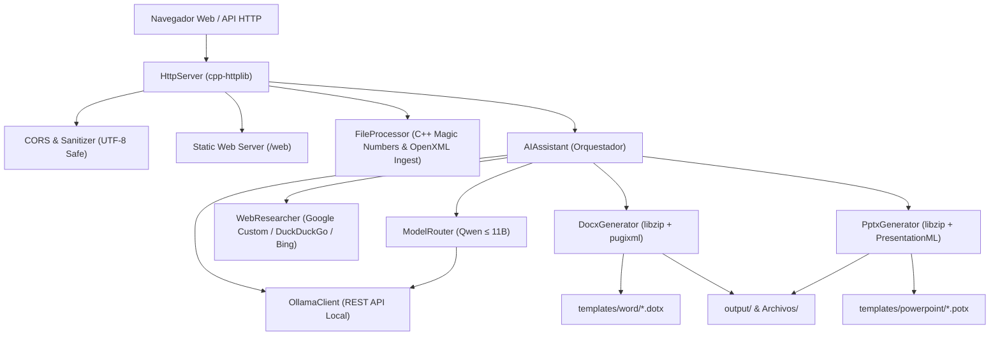

# Kofu C++ (v2.0)

<p align="center">
  
</p>

<p align="center">
  
  
  
  
  
  
  
  
  
</p>

---

## ⚡ ¿Qué es la rama Kofu C++?

Esta rama representa la **reimplementación nativa de alto rendimiento** del backend de Kofu escrita íntegramente en **C++20 y C**, orientada a latencia mínima, consumo ultra-bajo de memoria RAM y máxima portabilidad:

- 🚀 **Binario ultra-ligero de 969 KB**: Compilado con Link-Time Optimization (`-flto -O2 -march=native`), arranca en menos de **2 milisegundos**.
- 🧠 **Ecosistema de Modelos Qwen (≤ 11B)**: Optimizado para la familia de modelos abiertos de alto desempeño de Alibaba Cloud (`qwen2.5:7b`, `qwen2.5:3b`, `qwen2.5-coder:7b`, `qwen2.5:0.5b` y variantes fine-tuneadas).
- 📂 **Ingesta Documental Nativa en C++ (`FileProcessor`)**: Lee y extrae texto de archivos `.docx`, `.pptx`, `.xlsx`, `.pdf` y texto plano usando verificación estricta de *Magic Numbers* y parsing XML directo en microsegundos, sin dependencias externas de Python ni MarkItDown.
- 📑 **Generación Nativa de Office Open XML**: Crea documentos Word (`.docx`) y presentaciones PowerPoint (`.pptx`) desde cero o basados en plantillas (`.dotx` / `.potx`), preservando encabezados, pies de página, estilos y márgenes (`<w:sectPr>`) mediante manipulación DOM con `pugixml`.
- 🌐 **Servidor HTTP Multi-hilo Autocontenido**: Construido sobre `cpp-httplib`, `nlohmann/json`, `pugixml` y `libzip`, con soporte HTTPS (OpenSSL) y seguimiento de redirecciones para investigación web.
- 🖥️ **Frontend Futurista Integrado**: Sirve directamente la interfaz web interactiva en `/` y `/web`.

---

## 🧩 Arquitectura de Módulos



---

## 🤖 Configuración de Modelos Qwen (≤ 11B)

El enrutador dinámico (`ModelRouter`) asigna automáticamente el mejor modelo disponible según el tipo de tarea, con degradación elegante (*fallback chain*) priorizando modelos locales instalados:

| Tarea | Modelo Preferido | Modelos de Respaldo |
| :--- | :--- | :--- |
| **Razonamiento y Asistencia** | `qwen2.5:7b` | `qwen2.5:3b`, `qwen2.5:1.5b` |
| **Redacción de Documentos Word** | `qwen2.5:7b` | `qwen2.5:3b`, `qwen2.5:0.5b` |
| **Presentaciones PowerPoint** | `qwen2.5:7b` | `qwen2.5:3b`, `qwen3:0.6b` |
| **Investigación Web** | `qwen2.5:7b` | `qwen2.5:3b`, `qwen2.5:1.5b` |
| **Generación de Código / Markdown**| `qwen2.5-coder:7b` | `qwen2.5-coder:1.5b`, `qwen-2.5-coder-Uncensored` |
| **Sanitización y Corrección Rápida**| `qwen2.5:0.5b` | `qwen3:0.6b`, `qwen2.5:1.5b` |

---

## 📦 Requisitos y Dependencias

- **Compilador**: GCC 11+ o Clang 14+ compatible con C++20 / C++17.
- **CMake**: Versión 3.20 o superior.
- **Zlib / OpenSSL**: Opcionales del sistema (si OpenSSL está presente, activa HTTPS para web research).
- **Ollama**: Motor de inferencia local ejecutándose en `http://localhost:11434`.

> [!TIP]
> **Compilación 100% autocontenida:** `CMakeLists.txt` utiliza `FetchContent` con archivos tarball oficiales para descargar y compilar `cpp-httplib`, `nlohmann/json`, `pugixml` y `libzip` sin requerir paquetes `*-dev` del sistema con permisos de superusuario.

---

## 🔨 Compilación y Ejecución

### 1. Compilación de Release (Rendimiento Máximo)

```bash
# Configurar CMake con optimizaciones nativas
cmake -S kofu-cpp -B kofu-cpp/build -DCMAKE_BUILD_TYPE=Release

# Compilar en paralelo con todos los núcleos
cmake --build kofu-cpp/build -j$(nproc)
```

Para una compilación de depuracion con AddressSanitizer y UndefinedBehaviorSanitizer:

```bash
cmake -S kofu-cpp -B kofu-cpp/build-debug -DCMAKE_BUILD_TYPE=Debug
cmake --build kofu-cpp/build-debug -j$(nproc)
```

### 2. Iniciar el Servidor Nativo

```bash
./kofu-cpp/build/kofu
```

El servidor detecta automáticamente un puerto disponible (`8000`, `8080`, `3000`, `5000` o asignado por el SO) e imprime el banner de arranque:

```text
[Config] Loading from: "/home/alex/Documentos/Proyecto_Kofu/.env"

╔════════════════════════════════════════╗
║     Kofu C++ Backend v2.0.0            ║
║     http://localhost:8000               ║
╚════════════════════════════════════════╝
```

Abre tu navegador en `http://localhost:8000` para acceder a la interfaz futurista.

---

## ⚙️ Configuración (.env)

El ejecutable busca automáticamente un archivo `.env` en la raíz del proyecto. Las variables de entorno del sistema tienen precedencia sobre el archivo:

```dotenv
# Configuración Kofu C++
OLLAMA_BASE_URL=http://localhost:11434
OLLAMA_MODEL_PRIMARY=qwen2.5:7b
OLLAMA_MODEL_FALLBACK=qwen2.5:3b
LLM_MODEL_NAME=qwen2.5:7b
USE_LOCAL_LLM=true

# Búsqueda web (Opcional)
GOOGLE_API_KEY=
GOOGLE_CX=
```

---

## 🌐 API REST Endpoints

Todos los endpoints admiten CORS y procesan solicitudes en formato JSON o Multipart:

| Método | Ruta | Descripción |
| :--- | :--- | :--- |
| `GET` | `/health` | Diagnóstico del servidor, estado de Ollama y disponibilidad del ingestor. |
| `GET` | `/ollama/models` | Lista de modelos instalados en Ollama. |
| `GET` | `/templates` | Plantillas disponibles en `templates/word` y `templates/powerpoint`. |
| `POST` | `/chat` | Chat conversacional y razonamiento guiado con modelos Qwen. |
| `POST` | `/research` | Búsqueda web multicanal (Google / DuckDuckGo / Bing) y síntesis. |
| `POST` | `/office/word` | Genera documento `.docx` estructurado con estilos y plantillas. |
| `POST` | `/office/word/download` | Genera y descarga directamente el `.docx`. |
| `POST` | `/office/powerpoint` | Genera presentación `.pptx` profesional. |
| `POST` | `/office/powerpoint/download` | Genera y descarga directamente el `.pptx`. |
| `POST` | `/office/tips` | Consejos técnicos para Word o PowerPoint. |
| `POST` | `/text/correct` | Corrección ortográfica y de tipeo en español sin alterar codificación UTF-8. |
| `POST` | `/files/upload` | Carga de archivo e ingesta/extracción nativa instantánea de texto. |
| `POST` | `/files/digest` | Extrae y digiere el texto de cualquier archivo local compatible. |

---

## 📦 Empaquetado Multiplataforma (CPack & CI/CD)

El proyecto incluye soporte para empaquetado nativo en Linux, Windows y macOS:

```bash
cd kofu-cpp/build
cpack
```

Genera:
- **Linux**: Paquetes `.deb` y `.tar.gz`.
- **Windows**: Instalador NSIS `.exe` y `.zip`.
- **macOS**: Imagen de disco `.dmg` y `.tar.gz`.

El flujo automatizado de GitHub Actions se encuentra configurado en [`.github/workflows/build_releases.yml`](.github/workflows/build_releases.yml) para generar artefactos descargables al crear tags de versión (`v*`).

---

## 📄 Licencia

Este proyecto está bajo la Licencia MIT. Consulta el archivo [LICENSE](LICENSE) para más detalles.
